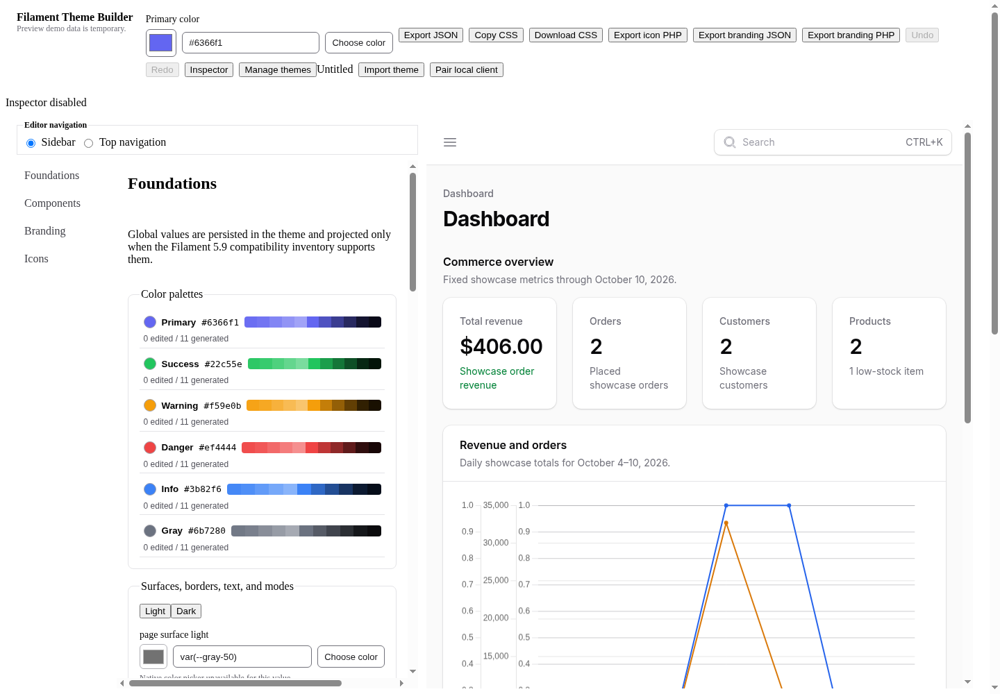
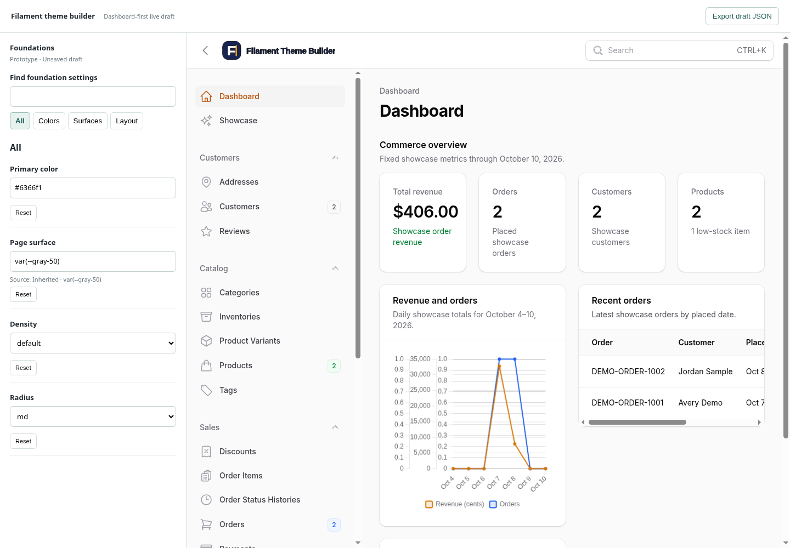
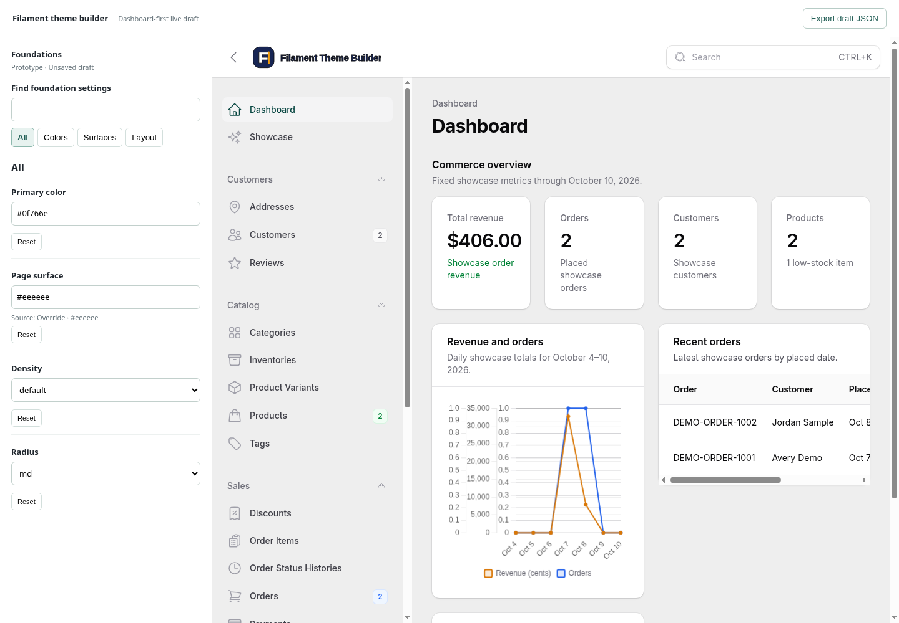
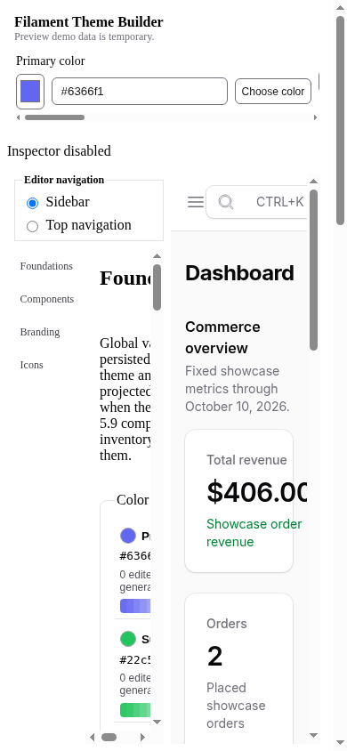
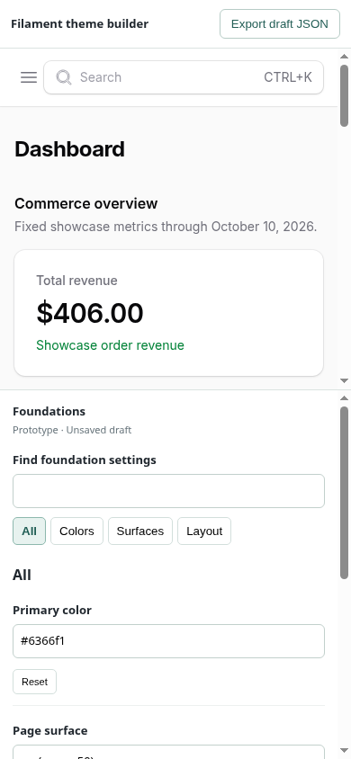

# Revised direction: dashboard-first editor

The user rejected the first five concepts because they hid the Filament preview, then selected **one cohesive layout**. The live dashboard is the core editing feedback surface, not an optional workspace. This revision supersedes the earlier settings-page/mock-preview direction.

[Open the interactive development prototype](http://127.0.0.1:4175/?dashboard-prototype=1).

## What changed

- **Real Filament dashboard, permanently in view.** A single persistent iframe uses the existing theme-preview bridge. This is not a sample dashboard or screenshot.
- **Compact 340 px editing dock on desktop.** The dashboard gets roughly 76% of a 1440 px workspace. Groups, search, inline validation, and resets stay in the dock.
- **Actual live feedback.** Primary color and page surface update the rendered dashboard as you edit. Density/radius use existing foundation actions and projection. Invalid drafts preserve the last valid preview; Reset removes the explicit customization.
- **Export does not cover the preview.** A small in-flow disclosure offers a real browser-only draft JSON download.
- **Mobile keeps both surfaces visible.** The real dashboard sits above an independently scrolling editing dock. There is no Edit/Preview replacement tab and no outer-page scrolling that can carry the dashboard away.
- **Isolated draft.** No production theme persistence is used. This is a focused foundations prototype, not a migration of every editor capability; it does not yet include the full palette, typography, branding, icons, inspector, or theme-management inventory.

## Desktop: before & after

### Before — current editor, 1440 × 1000

### After — cohesive layout, 1440 × 1000

### Live feedback in that same layout

Primary color changed to `#0f766e`, page surface changed to `#eeeeee`. The dashboard's active navigation and background update without replacing the preview document.

## Mobile: before & after

### Before — current split layout, 390 × 844

### After — dashboard above dock, 390 × 844

At this size, the dashboard occupies 379 px beneath the 54 px toolbar; the dock gets the remaining 411 px. Neither horizontal nor vertical outer-page overflow was observed. Each pane scrolls independently.

## Verification

- Focused Playwright: **3 expanded tests passed** after final fixes. Includes live iframe CSS, invalid drafts/reset, search/empty state, real download, production-storage isolation, iframe document/window stability, export-open hit testing, and desktop/900 px/mobile/short-mobile layout.
- Type-check and production build passed; CSS-only ordering repair passed build-only while reusing unchanged TypeScript evidence.
- Full unit suite completed successfully: **123 files / 533 tests passed**. That run preceded the final prototype-only repairs; unchanged production coverage was reused rather than rerun.
- Independent review approved the cohesive reset/viewport repair. Controller reviewed the final narrow mobile-ordering fix and its additional document-identity/hit-test regressions, then visually checked desktop and mobile screenshots.
- Screenshots come from actual browser rendering in isolated contexts. Only third-party Vue devtools/inspector overlays were hidden, including inside the iframe; product UI was not hidden or rewritten for capture.

The ordinary editor, prior prototype routes, and existing user edits remain intact. No production promotion, dependency installation, backend mutation from editor controls, or new MCP capability was added. The real embedded demo still retains its normal interactions; the prototype does not enforce a read-only sandbox.

See [verification evidence](2026-10-23-dashboard-first-evidence.md) and [progress](2026-10-23-editor-guidelines-progress.md).
