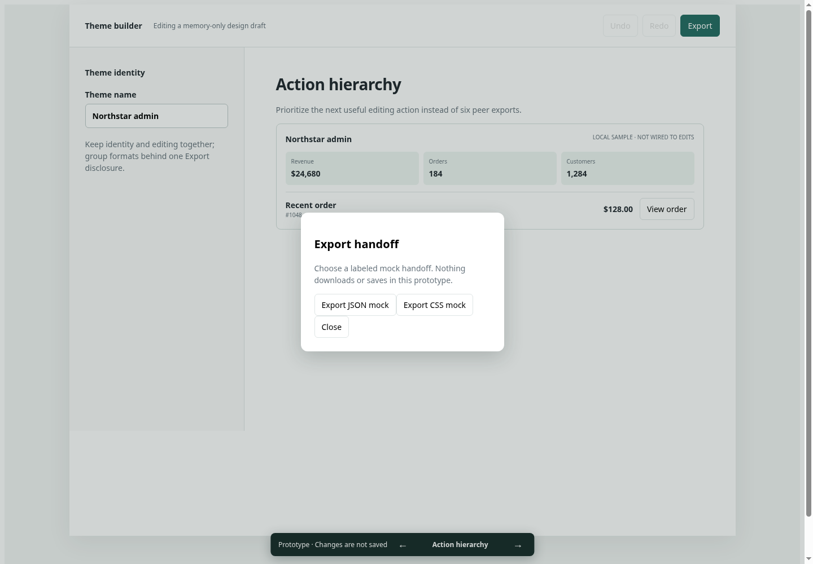
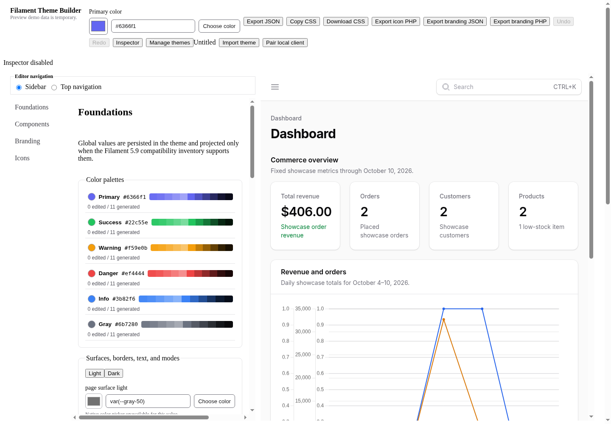
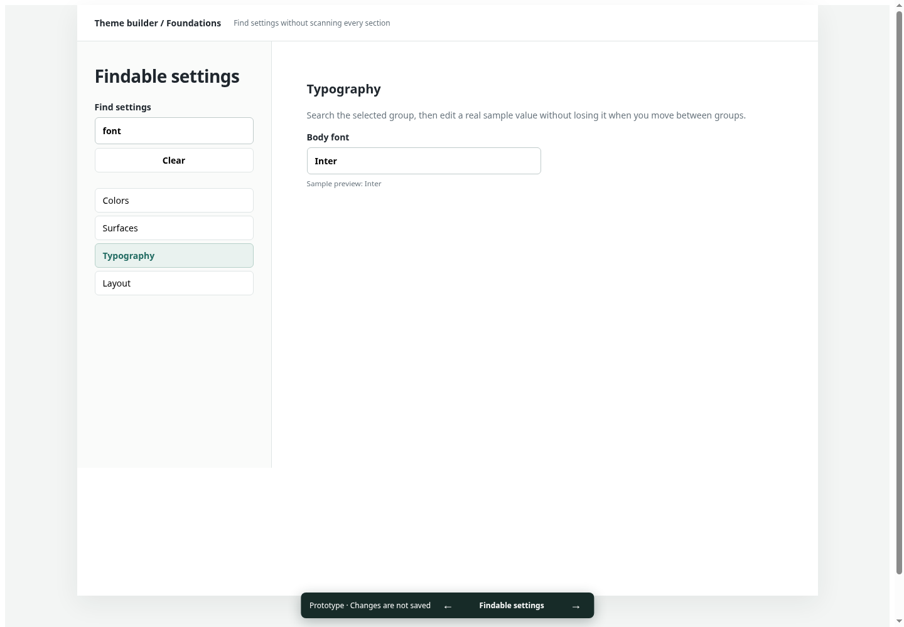
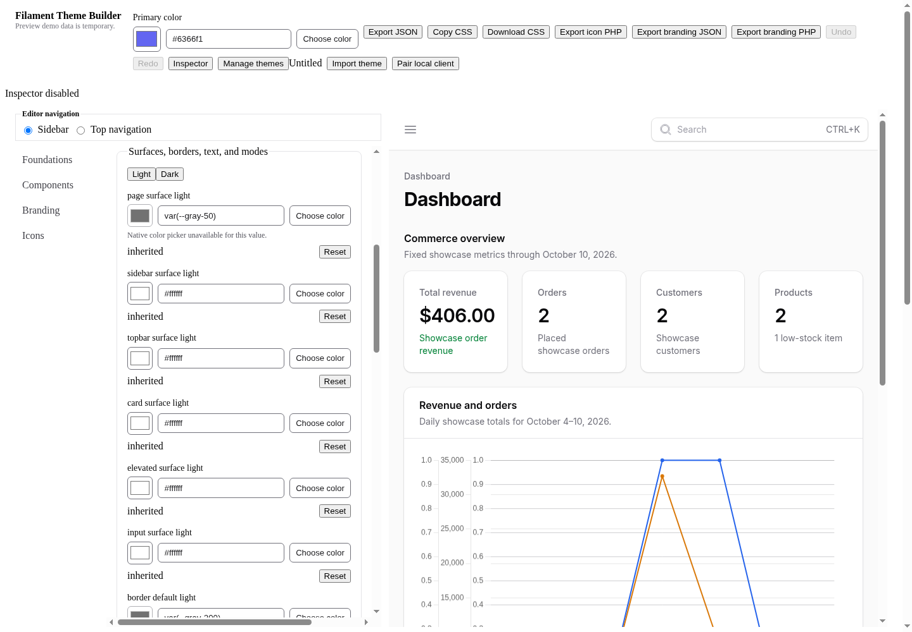
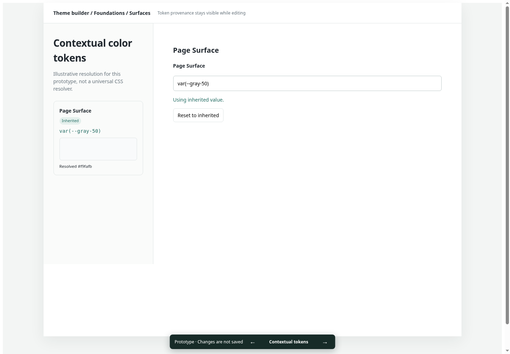
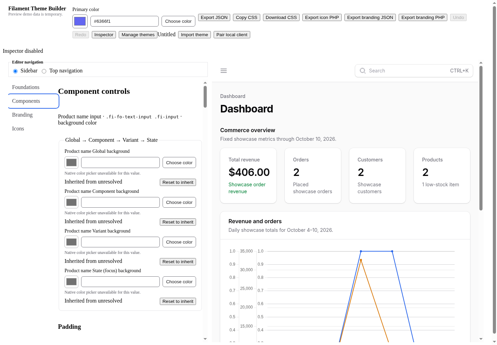
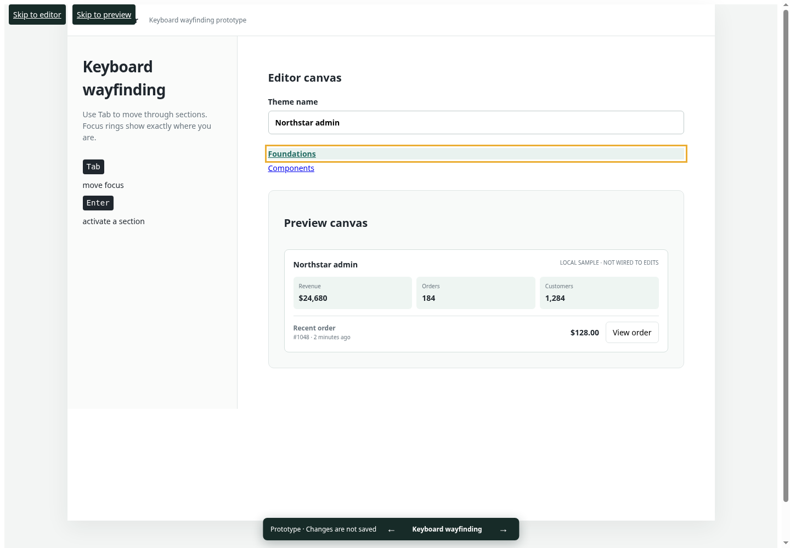
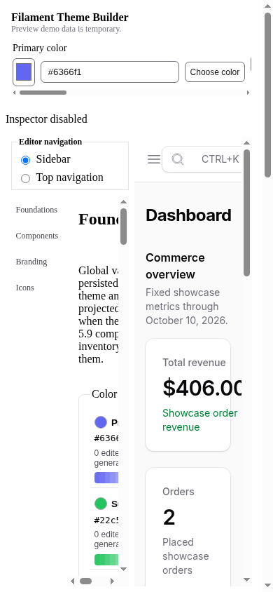
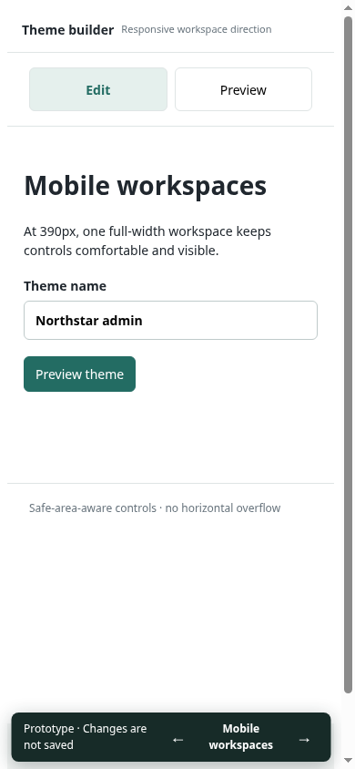

# Editor review: five improvements to try

> **Superseded design direction:** The user rejected most of these prototypes because they hid the real dashboard. The [revised cohesive dashboard-first prototype](2026-10-23-dashboard-first.md) preserves the actual live Filament preview throughout editing. The findings below remain historical audit context, not an accepted layout direction.

Reviewed the live `builder/` editor and its shell, navigation, color fields, and responsive styles using the [Vercel Web Interface Guidelines](https://github.com/vercel-labs/web-interface-guidelines/blob/main/command.md), fetched October 23, 2026. This is a targeted editor review, not a complete accessibility certification.

**Before** images show the real current editor. **After** images show isolated, low-fidelity Vue interaction prototypes. Sample dashboards are explicitly local mock data, not the production preview. The simplification is intentional: each prototype explores one question, not removal of the editor's remaining features. No direction has been selected or promoted.

Open any prototype while the existing Compose development stack is running. Use the bottom arrows (or Left/Right outside text controls) to switch ideas. Changes stay in memory and are not saved or exported. The normal editor and existing visual prototypes remain available and unchanged.

## 1. Make the toolbar editing-first

**Observation:** Six export/copy actions compete with theme management, history, inspection, import, pairing, and primary-color editing. The toolbar wraps at desktop widths and becomes horizontally scrolled on mobile. The editor also inherits the browser's serif body font, unlike the preview.

**Prototype:** A compact toolbar with clear theme identity, working memory-only Undo/Redo, and one Export entry point. Export opens a keyboard-accessible modal with mock format choices, Escape support, and focus restoration. A system-font hierarchy makes the editor easier to scan.

**Classification:** UX recommendation, informed by Vercel's specific-action-label and focus guidelines; Vercel does not mandate one Export button or a particular font. The prototype offers two example formats, not a complete replacement of the existing export inventory.

### Source findings

- `builder/src/components/EditorToolbar.vue:58` — editing and six export actions share the same undifferentiated control row.
- `builder/src/styles/editor-responsive.css:22` — controls wrap; narrow layout changes to a horizontally scrolling row.
- `builder/src/app.css:1` — theme/utilities imports do not establish editor body typography; live body resolves to Times New Roman.

[Try the action prototype](http://127.0.0.1:4175/?guidelines-prototype=1&variant=actions).

**Before**

**After**

## 2. Make settings findable and shareable

**Observation:** Foundations is a long scrolling stack. Typography and layout controls are well below the palettes and surface controls. The selected editor section is held in memory, so its location cannot be shared or restored from the URL.

**Prototype:** A search field plus Colors, Surfaces, Typography, and Layout groups. Results are editable sample settings; values remain while moving between groups. Search and group state live in the URL, reload correctly, and support Back/Forward. Empty searches have a clear recovery action.

**Classification:** URL-state/empty-state guideline improvement plus a discoverability recommendation. Search in this prototype covers the selected sample group, not every production setting.

### Source findings

- `builder/src/composables/use-builder-controls.ts:27` — section selection updates a ref but not URL state.
- `builder/src/components/FoundationsPaletteControls.vue:28` — palettes occupy the first substantial Foundations block; no subgroup/search entry point.
- `builder/src/components/FoundationsTypographyControls.vue:19` — Typography is a separate fieldset in the same long scrolling panel.

[Try the navigation prototype](http://127.0.0.1:4175/?guidelines-prototype=1&variant=navigation&q=font&group=Typography).

**Before**

**After**

## 3. Explain color tokens instead of showing an unavailable picker

**Observation:** A token such as `var(--gray-50)` produces a disabled native picker and an unavailable-picker message. Its displayed fallback does not explain the resolved color. The inherited status exists, but source, effective value, and editing context are dispersed.

**Prototype:** A contextual token editor showing the source, Inherited/Override badge, resolved swatch, and one labeled value field. Valid hex edits update immediately; invalid drafts show corrective text and preserve the last valid swatch/source. Reset or manually entering the supported token restores inheritance.

**Classification:** Content clarity recommendation plus Vercel form metadata/error guidance. Existing production labels, validation, reset behavior, and live status are acknowledged, not claimed absent. Token resolution here is illustrative: only `var(--gray-50)` and six-digit hex are supported.

### Source findings

- `builder/src/components/ColorField.vue:18` — native picker support is limited to literal hex values.
- `builder/src/components/ColorField.vue:19` — unsupported token values use a fallback rather than displaying resolved token context.
- `builder/src/components/ColorField.vue:39` — code/color text input lacks `name`, explicit autocomplete control, and disabled spellcheck.
- `builder/src/components/ColorField.vue:42` — unavailable-picker copy explains a limitation, not the effective color or a next step.

[Try the token prototype](http://127.0.0.1:4175/?guidelines-prototype=1&variant=tokens).

**Before**

**After**

## 4. Improve keyboard wayfinding and active-section visibility

**Observation:** The current editor already has keyboard tab navigation and focus rings. However, the sidebar selected-state selector expects `aria-current="page"` while its buttons emit `aria-selected`. Active styling therefore misses the sidebar. The outer builder has no skip links, although the embedded Filament demo has its own.

**Prototype:** Skip-to-editor and skip-to-preview links, conspicuous keyboard focus, truthful Tab/Enter guidance, and section navigation whose visible current state updates. The screenshot shows keyboard focus separately from selected state.

**Classification:** Direct Vercel accessibility/focus/interactive-state findings. This prototype demonstrates wayfinding only; it is not a replacement for the production editor's full tab semantics.

### Source findings

- `builder/src/components/EditorNavigation.vue:16` — sidebar buttons emit `aria-selected`.
- `builder/src/styles/editor-shell.css:67` — sidebar selected styling targets `aria-current`, unlike the actual markup.
- `builder/src/components/BuilderShell.vue:14` — main builder starts without an editor/preview skip-navigation path.

[Try the keyboard prototype](http://127.0.0.1:4175/?guidelines-prototype=1&variant=keyboard).

**Before**

**After**

## 5. Give mobile one usable workspace at a time

**Observation:** At 390 px, editor and preview each receive about half the width. The editor then subdivides again into its navigation rail and controls. Labels and fields become clipped or require nested scrolling; the preview is similarly cramped.

**Prototype:** Full-width Edit and Preview workspaces with large switch controls, a draft that survives switching, and a safe-area-aware bottom prototype navigator. This preserves control width instead of shrinking desktop columns.

**Classification:** Safe-layout/touch guideline improvement. Edit/Preview switching is a proposed solution, not a layout mandated by Vercel. This narrow prototype exercises a theme-name draft rather than the full production control inventory.

### Source findings

- `builder/src/styles/editor-mobile.css:27` — narrow layout retains two side-by-side workspace columns.
- `builder/src/styles/editor-mobile.css:33` — the already-narrow editor is split again for its sidebar.
- `builder/src/styles/editor-navigation.css:43` — foundation rows have minimum column widths larger than their mobile allocation.

[Try the mobile prototype](http://127.0.0.1:4175/?guidelines-prototype=1&variant=mobile).

**Before — 390 × 844**

**After — 390 × 844**

## Recommendation & verification

Prioritize **mobile workspace width** and **keyboard/active-section styling**, then **settings discovery**, **token context**, and **toolbar consolidation**. The first two address concrete observed access/layout problems; the remaining directions should be judged against real editing workflows before promotion.

- Focused Playwright checks passed; targeted query-history and token-transition checks passed after the relevant repairs.
- `npm run type-check` and `npm run build` passed.
- Independent scoped correctness/spec and quality review approved the repaired prototypes.
- **Full unit suite is unresolved:** timeout failures in one run and a command timeout in another. Their attribution is unknown; this is not a fully green application regression run.
- Screenshots were captured from real browser rendering in isolated contexts: desktop 1440 × 1000, mobile 390 × 844. Third-party Vue devtools overlays alone were hidden consistently for legibility. The token before image scrolls Foundations to Surfaces; keyboard images use keyboard-driven focus. First two before images intentionally share the same initial editor state.
- No production behavior, stored themes, demo data, dependencies, or MCP capability was changed. Prototype routes are development-only. No direction has been integrated into production.

See [verification evidence](2026-10-23-editor-guidelines-evidence.md) and the [progress ledger](2026-10-23-editor-guidelines-progress.md).
